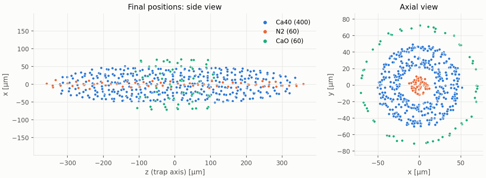
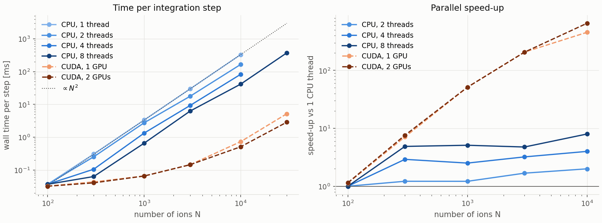

# Ion_MD

ion_md is a molecular dynamics (MD) simulation of ions in a linear Paul trap. Newton's equations of motion of every ion are integrated with the velocity Verlet (leapfrog) scheme. The physical model follows

- C. B. Zhang *et al.*, Phys. Rev. A **76**, 012719 (2007) [[1]](#references), and
- C. B. Zhang, PhD thesis, Heinrich-Heine-Universität Düsseldorf (2008) [[2]](#references),

and the earlier but incomplete IonMD version by Michael V. DePalatis [[3]](#references).

The O(N) parts of every step run in parallel with **OpenMP**; the O(N²) Coulomb interaction (the dominant cost) runs either on the CPU (OpenMP + SIMD) or on one or more **NVIDIA GPUs (CUDA)**.

Remark: This was an old project from graduate school days. I need to move it to GitHub because the old laptop for this project is being phased out.

## Contents

- [Model](#model)
- [Dependencies](#dependencies)
- [Building on the HPC](#building-on-the-hpc-8-cpus-2--tesla-v100)
- [Running](#running)
- [Testing](#testing)
- [Methods, parallelisation and performance](docs/METHODS.md) (separate document)
- [Authors](#authors) · [License](#license) · [References](#references)

## Model

$$
m_i \ddot{\vec r}_i = \vec F^{\mathrm{trap}}_i + \vec F^{\mathrm{Coulomb}}_i + \vec F^{\mathrm{laser}}_i
                    + \vec F^{\mathrm{exc}}_i \quad (+\ \text{stochastic velocity kicks})
$$

- **Trap** (`trap` section): Potential

$$
\phi = \frac{(U_{dc} + V_{rf}\cos\Omega t)(x^2-y^2)}{2 r_0^2} + \frac{\kappa U_{ec}(2z^2 - x^2 - y^2)}{2 z_0^2},
$$

  i.e. Mathieu parameters $q = 2QV_{rf}/(m r_0^2 \Omega^2)$ and $a = 4QU_{dc}/(m r_0^2 \Omega^2)$. Either the **pseudopotential** (time-averaged, large time steps; `forces.secular`) or the **full rf field with micromotion** (`forces.micromotion`, time step ≈ 1/100 of the rf period).

- **Coulomb**: Direct pairwise sum, $\vec F_i = k_e q_i \sum_{j\neq i} q_j (\vec r_i - \vec r_j)/|\vec r_i - \vec r_j|^3$.

- **Laser cooling** (`lasers`, `forces.doppler`): Damping model, PRA Eq. 14: $\vec F = -\beta \vec v + F_0 \hat k$ on ions with
  `laser_cooled: true`. `directional: true` damps only $\vec v\cdot\hat k$ (single beam).

- **Heating** (`stochastic`, `forces.stochastic`): Velocity kicks of fixed magnitude and random direction every step
  (PRA Eqs. 10–12): $v_0 = \sqrt{2 k_B h\, dt / m}$, so the energy grows at
  $k_B h$ per ion ($h$ = `heating_rate` in K/s, global or per species).

- **Secular excitation** (`excitation`, `forces.excitation`): Uniform field $E_0 \cos(2\pi f t)\,\hat e$ for $t_\mathrm{start} \le t < t_\mathrm{stop}$
  (thesis Ch. 10). With `frequency: 0` and a short `t_stop` it is a broadband kick.

- **Minimisation** (`simulation.equilibrate_steps`): As in the original `minimize()`: strongly damped run (`equilibrate_beta`,
  pseudopotential, no heating) to form a crystal, then velocities are reset to zero.

- **Diagnostics**: Secular temperature (PRA Eq. 6, velocities averaged over each rf period when micromotion is on) per species, kinetic temperature (incl. micromotion energy, Eq. 7), kinetic/trap/Coulomb/total energy, centre-of-mass motion per species (for secular spectra), and simulated CCD images (2-D histograms of the positions projected on the x-z plane).

Random numbers are counter-based (a hash of seed, step and ion index), so
results are **bit-for-bit identical for any number of OpenMP threads**.

## Dependencies

- C++17 compiler (GCC >= 8; tested with GCC 14.2), CMake >= 3.18
- OpenMP (optional, on by default)
- CUDA toolkit (optional) for the GPU backend
- Python 3 with numpy and matplotlib for the analysis scripts

## Building on the HPC (8 CPUs, 2 Tesla V100)

```bash
source scripts/hpc_env.sh     # gcc/13.1.0, cmake/3.27.7, cuda12.8 toolkit, python+numpy+matplotlib
bash scripts/build.sh         # configures with CUDA if nvcc is found, builds, runs unit tests
```

or by hand:

```bash
module load gcc/13.1.0 cmake/3.27.7-gcc-13.1.0 cuda12.8/toolkit/12.8.1
cmake -S . -B build -DCMAKE_BUILD_TYPE=Release \
      -DIONMD_USE_CUDA=ON -DCMAKE_CUDA_ARCHITECTURES=70 -DIONMD_NATIVE=ON
cmake --build build -j 8
./build/app/ionmd --info      # shows OpenMP threads and the visible GPUs
(cd build/tests && ./tests)   # unit tests incl. CPU/GPU agreement
```

Notes:

- The V100 is compute capability 7.0, hence `CMAKE_CUDA_ARCHITECTURES=70`.
- nvcc in CUDA <= 12.3 rejects GCC 13 as host compiler. Use `cuda12.4` or
  `cuda12.8` (recommended) with `gcc/13.1.0`. If you must use
  `cuda/12.2.1-gcc-13.1.0`, add `-DCMAKE_CUDA_FLAGS=-allow-unsupported-compiler`
  (at your own risk) or use `gcc-8.5.0` toolchains throughout.
- `-DIONMD_NATIVE=ON` adds `-march=native`: build on the compute node type
  you will run on (or leave it off).
- CPU-only build: `bash scripts/build.sh --cpu` (or `-DIONMD_USE_CUDA=OFF`).

## Running

Simulations are described by a JSON file (all keys optional; see
[`include/ionmd/config.hpp`](include/ionmd/config.hpp) for the full list and
[`tests/configs/`](tests/configs/) for examples):

```bash
./build/app/ionmd tests/configs/06_sympathetic_cooling.json -o results/symp
python3 python/plot_run.py results/symp            # figures in results/symp/figures
```

Here is one of the figures from this simulation:



Command line options (override the configuration file):

| Option | Meaning |
|---|---|
| `-o DIR` | output directory |
| `-b cpu\|cuda\|auto` | Coulomb backend |
| `-t N` | OpenMP threads |
| `-g N` | GPUs (0 = all) |
| `-n N` | production steps |
| `-N N` | rescale the ion number (benchmarks) |
| `-q` | quiet |
| `--info` | print build and device information |

Parallelism:

- OpenMP threads: `-t 8` or `OMP_NUM_THREADS=8` (`scripts/hpc_env.sh`
  also sets `OMP_PROC_BIND=close OMP_PLACES=cores`).
- GPUs: backend `cuda` or `auto` (GPU when N ≥ `gpu_min_ions`, default 256).
  The target ions are split between the GPUs, each GPU computing the Coulomb
  forces on its share. Two GPUs only pay off for several thousand ions;
  smaller systems automatically use one GPU. `CUDA_VISIBLE_DEVICES` is respected.
- Batch jobs (8 cores, 2 GPUs, 30 GB; submit from the repository root;
  `CONFIG` is the path of your JSON file):

  ```bash
  # PBS (qsub cannot pass arguments to a job script, hence -v)
  qsub -v CONFIG=tests/configs/06_sympathetic_cooling.json scripts/job_run.sh
  qsub -v CONFIG=my.json,ARGS="-N 5000 -n 500000" scripts/job_run.sh
  # SLURM
  sbatch scripts/job_run.sh my.json -N 5000 -n 500000
  # directly, e.g. in an interactive session on a GPU node
  qsub -I -X -l select=1:ncpus=8:ngpus=2:mem=30gb    # then, in the repository:
  bash scripts/job_run.sh my.json -N 5000 -n 500000
  ```

  Results and figures go to `results/<config name>_<job id>/`. Adapt the
  `#PBS -q` / `#SBATCH --partition` line in the script if your cluster needs
  a named GPU queue.

Output files (in the output directory):

| File | Content |
|---|---|
| `config.json` | complete configuration incl. derived q and secular frequencies |
| `run_info.json` | metadata (species, frames, timing, backend, status) |
| `initial_state.csv` | state at the start of production (after minimisation) |
| `final_state.csv` | final positions/velocities; `final.xyz` in µm |
| `diagnostics.csv` | t, T_sec (all and per species), T_kin, energies |
| `trajectory.bin` | float32 positions [m], shape (frames, N, 3) |
| `velocities.bin` | float32 velocities, if `record_velocities` |
| `com.bin` | float64 COM per species, shape (frames, S, 3) |
| `ccd.bin` | float64 CCD histograms, shape (S, bins, bins); rows x, cols z |

[`python/ionmd_io.py`](python/ionmd_io.py) reads all of these (`Run(dir)`).

## Testing

1. **Unit tests** (`build/tests/tests`, Catch): vector algebra, trap forces
   vs. potential gradients, Coulomb forces (Newton's 3rd law, F = −∇U),
   CUDA vs. CPU agreement (on a GPU node), single-ion secular frequency,
   two-ion and five-ion chain equilibria (James 1998), energy conservation,
   laser cooling rate β/m, heating rate (Eq. 12), micromotion secular
   frequency, thread-count independence, output files, abort on instability.

2. **Physics test suite**:

   ```bash
   bash scripts/run_tests.sh results/tests       # THREADS=8 BACKEND=auto by default
   ```

   runs `tests/configs/0*.json` and `python/analyze_tests.py`, which checks
   each run against theory and writes figures and `summary.md`:

   | # | Test | Check |
   |---|---|---|
   | 01 | single ion secular | FFT peaks = pseudopotential f_x, f_y, f_z |
   | 02 | single ion micromotion | secular peak = exact Mathieu β; rf sidebands |
   | 03 | linear chain (10 ions) | positions = numerical James equilibrium |
   | 04 | laser cooling (300 ions) | T_sec decays as exp(−βt/m); crystal / CCD |
   | 05 | heating (200 ions) | dE_total/dt = N k_B h (PRA Fig. 7) |
   | 06 | sympathetic cooling | Ca⁺ cools N₂⁺ and CaO⁺; radial mass ordering; CCD |
   | 07 | secular spectrum | COM resonances of each species (thesis Ch. 10) |
   | 08 | micromotion crystal | T_sec ≪ T_kin (PRA Fig. 2) |
   | 09 | backend consistency | CPU and CUDA final states agree (GPU node) |

3. **Benchmark**: `bash scripts/run_benchmark.sh` measures the time per step
   for N = 100 … 30000 with 1/2/4/8 threads and 1/2 GPUs and plots it
   (`python/plot_benchmark.py`).

   Here is the result from the benchmark test:
   

`qsub scripts/job_tests.sh` (PBS), `sbatch scripts/job_tests.sh` (SLURM) or
`bash scripts/job_tests.sh` (directly on a GPU node) builds the code and runs
all three in one go.

## Authors

ion_md was written by Vu Tran based on the earlier but incomplete IonMD version of Michael V. DePalatis.
Claude Code was used to create METHODS.md, test units and shell scripts.

## License

GNU GPL version 3

## References

1. C. B. Zhang, D. Offenberg, B. Roth, M. A. Wilson and S. Schiller,
   Phys. Rev. A **76**, 012719 (2007).
2. C. B. Zhang, *Production and Sympathetic Cooling of Complex Molecular
   Ions*, PhD thesis, Heinrich-Heine-Universität Düsseldorf (2008).
3. Michael V. DePalatis, IonMD GitHub (https://github.com/mivade/IonMD)
4. D. F. V. James, Appl. Phys. B **66**, 181 (1998).
